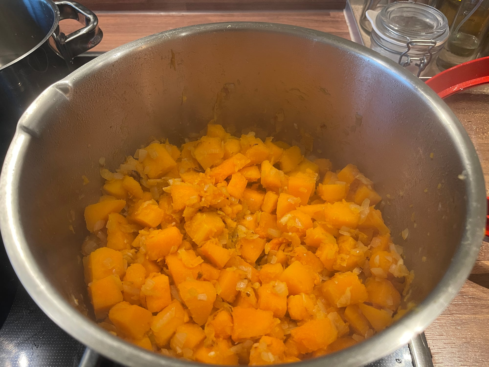
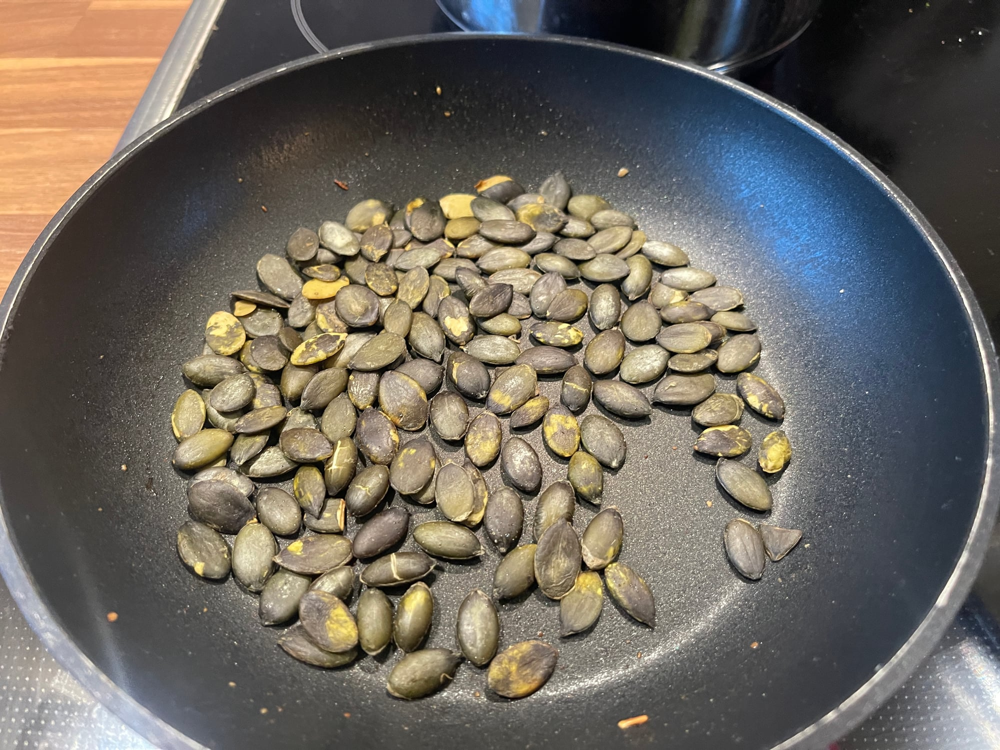

## Zutaten

### Suppe

- {{1}} Butternusskürbis (ca. {{1 kg}}), entkernt, geschält und grob gewürfelt
- {{2}} Zwiebeln, gewürfelt
- {{40 g}} Butter
- {{2 TL}} Salz
- {{800 ml}} Gemüsebrühe

### Zum Garnieren

- {{2 EL}} Kürbiskerne
- {{200 g}} Crème fraîche
- {{1/2 TL}} Cayennepfeffer
- Frische Kräuter (nach Belieben)
- Muskatnuss, Salz

## Equipment

- Großer Topf mit Deckel
- Pfanne
- Pürierstab

## Zubereitung

1. **Vorbereiten:** Kürbis waschen, halbieren und mit einem Löffel entkernen. Schälen und grob würfeln. Zwiebeln schälen und würfeln.
2. **Anschwitzen:** Butter in einem großen Topf schmelzen. Kürbis und Zwiebeln darin 1–2 Min. anschwitzen, {{2 TL}} Salz zugeben und weitere 2 Min. dünsten.
   
3. **Köcheln:** Mit Gemüsebrühe aufgießen und zugedeckt bei mittlerer Hitze ca. 20 Min. köcheln lassen, bis der Kürbis weich ist.
4. **Toppings vorbereiten:** Kürbiskerne in einer Pfanne ohne Fett bei mittlerer Hitze 2–3 Min. rösten. Crème fraîche mit einer Prise Salz glatt rühren.
   
5. **Pürieren:** Suppe mit dem Pürierstab fein pürieren und mit Muskatnuss, Cayennepfeffer und Salz abschmecken.
6. **Servieren:** Suppe auf Schalen verteilen, mit Crème fraîche verfeinern und mit Kürbiskernen und gehackten Kräutern bestreuen.

## Tipps

- Die Kürbiskerne werden besonders knusprig, wenn man sie vor dem Rösten leicht mit Mehl bestäubt.
