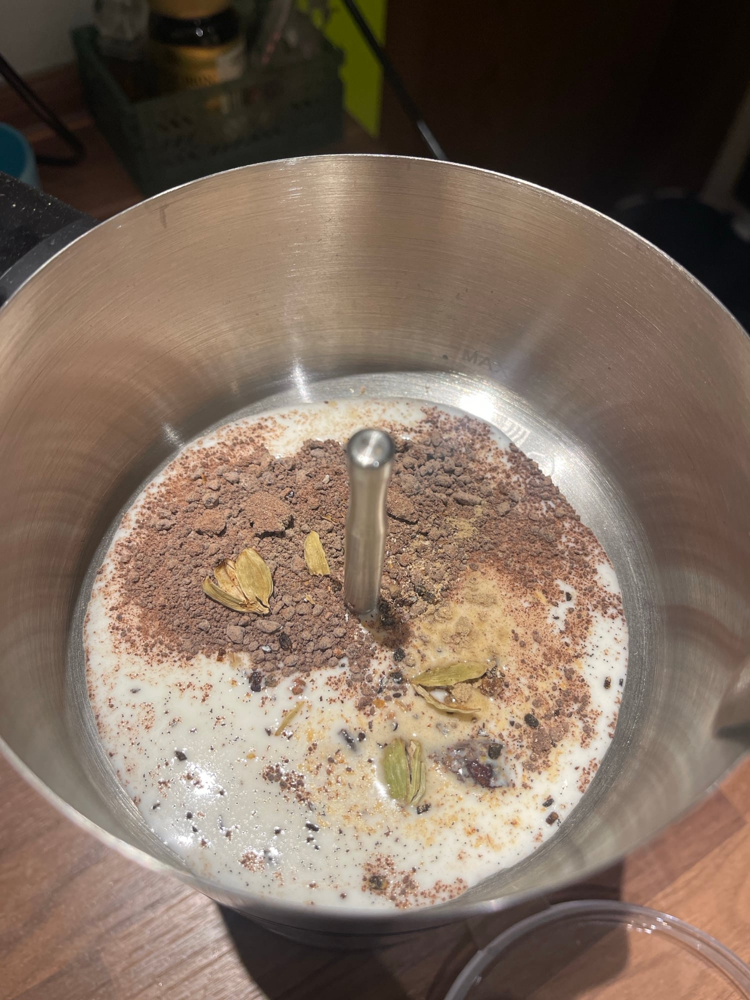
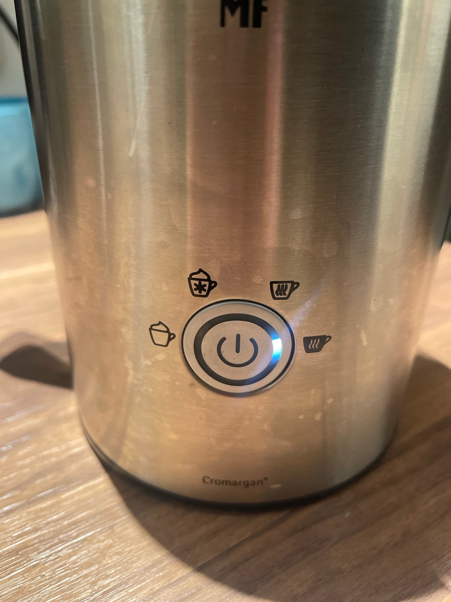

## Zutaten
- ca. {{300 ml}} Milch (große Tasse zu ca. 3/4 voll), plus etwas zum Auffüllen
- {{1,5 EL}} Zartbitterkuvertüre, zerkleinert
- {{5}} Umdrehungen Vanille aus der Mühle
- {{3}} Umdrehungen Muskatnuss aus der Mühle
- {{1}} Gewürznelke
- {{1}} Zacke Sternanis
- {{1}} Prise Kardamom, gemahlen
- {{3}} Kardamomkapseln
- Zimt (nach Belieben)

## Equipment
- Elektrischer Milchaufschäumer (mit Programm „heiße Milch“)
- Mörser
- Große Tasse

## Zubereitung
1. **Milch abmessen:** Große Tasse zu ca. 3/4 mit Milch füllen und die Milch in den Milchaufschäumer geben.
2. **Würzen:** Kuvertüre, Vanille und Muskatnuss in die Milch geben. Nelke in der Mitte durchbrechen und mit der Sternanis-Zacke und dem gemahlenen Kardamom hinzufügen. Kardamomkapseln im Mörser zerstoßen und ebenfalls dazugeben, nach Belieben etwas Zimt.
   
3. **Erhitzen:** Milchaufschäumer auf das Symbol mit der dunklen, warmen Kaffeetasse (heiße Milch ohne Schaum) stellen – das Programm startet von allein. Zwischendurch den Deckel abnehmen und in der Mitte etwas von Hand mitrühren, bis der Piepton ertönt.
   
4. **Servieren:** Heiße Schokolade in die Tasse füllen und bei Bedarf mit etwas Milch auffüllen.

## Tipps
- Milchaufschäumer direkt danach reinigen: eingeschaltet lassen und Wasser mit etwas Spülmittel hineingeben.
