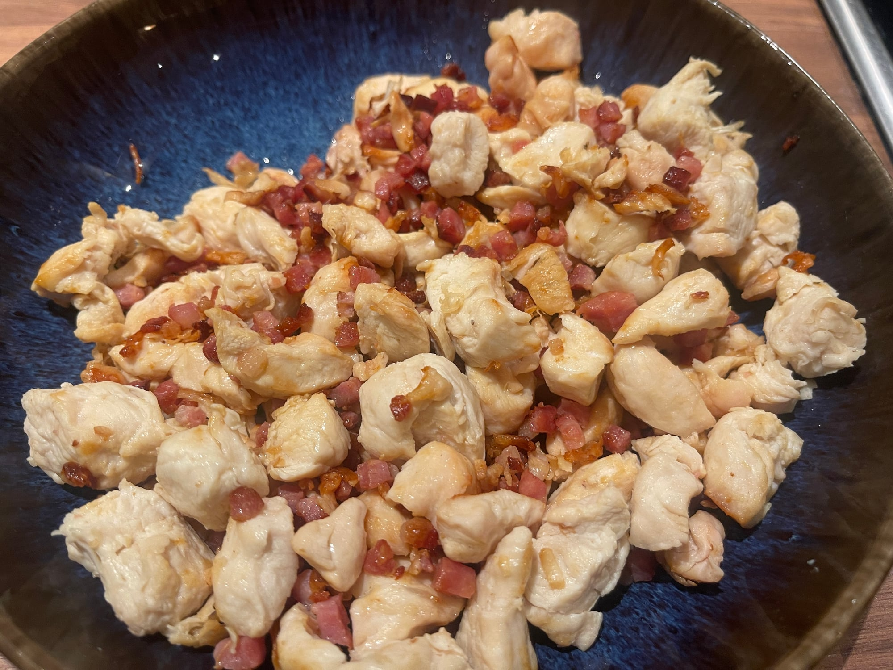
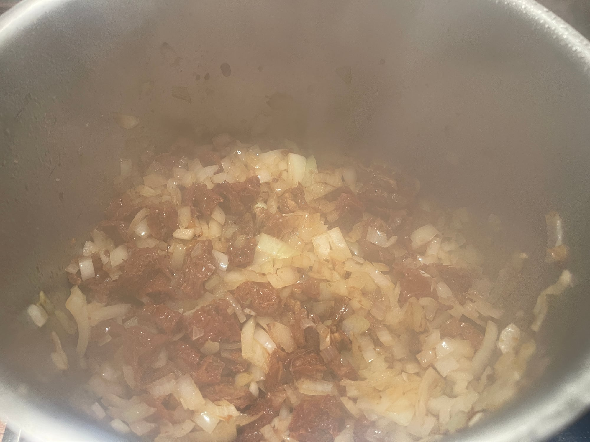

## Zutaten
- {{150 g}} Nudeln nach Wahl
- {{50 g}} Speckwürfel
- {{250 g}} Hähnchenbrust, in mundgerechte Würfel geschnitten
- {{1}} Zwiebel, fein gewürfelt
- {{2}} Knoblauchzehen, fein gehackt
- {{50 g}} getrocknete Tomaten in Öl, abgetropft und klein geschnitten
- {{200 ml}} Kochsahne
- {{300–400 ml}} Gemüsebrühe
- ca. {{50 g}} Spinat (1 Handvoll)
- {{40 g}} Parmesan, gerieben
- frisches Basilikum
- Öl, Salz, Pfeffer, Paprikapulver, Chiliflocken

## Equipment
- Großer Topf
- Topf für die Nudeln

## Zubereitung
1. **Nudeln kochen:** Nudeln in reichlich Salzwasser nach Packungsangabe bissfest kochen, abgießen und beiseitestellen.
2. **Anbraten:** Speckwürfel und Hähnchen in wenig Öl im großen Topf bei hoher Hitze scharf anbraten, mit Salz, Pfeffer und Paprikapulver würzen. Herausnehmen und beiseitestellen.
   
3. **Basis:** Zwiebel, Knoblauch und getrocknete Tomaten im gleichen Topf bei mittlerer Hitze anbraten, bis die Zwiebeln goldbraun sind.
   
4. **Ablöschen:** Mit Sahne und {{300 ml}} Brühe aufgießen und ca. 5 Min. köcheln lassen. Für eine dünnere Suppe bis zu {{100 ml}} Brühe mehr nehmen.
5. **Verfeinern:** Spinat und Parmesan dazugeben und gut umrühren, bis der Spinat zusammengefallen und der Käse geschmolzen ist.
6. **Fertigstellen:** Hähnchen und Speck zurück in die Suppe geben, kurz erhitzen und mit Salz, Pfeffer und Chiliflocken abschmecken.
7. **Servieren:** Nudeln auf Teller verteilen, Suppe darübergeben und mit frischem Basilikum bestreuen.

## Tipps
- Laut Quelle reicht das Rezept für 2–3 Portionen.
