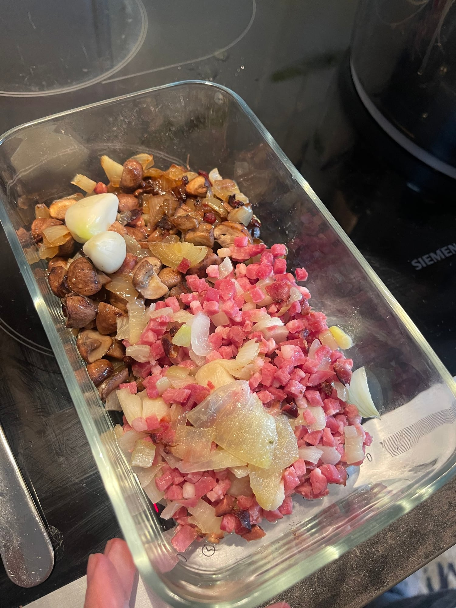
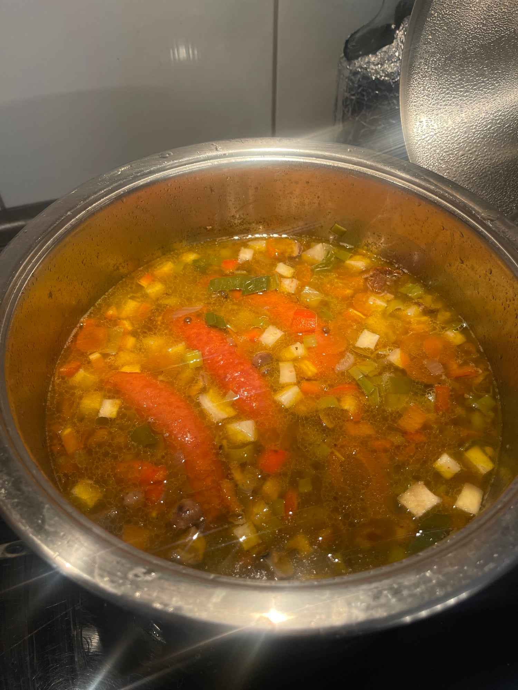

## Zutaten

### Hühnerbrühe
- {{1–2}} Hühnerkarkassen (vom Markt)
- {{1 Bund}} Suppengrün (Karotte, Knollensellerie, Porree, Petersilie)
- {{1}} Zwiebel, halbiert
- ca. {{3,5 l}} Wasser

### Eintopf
- {{500 g}} Belugalinsen, über Nacht eingeweicht
- {{150 g}} Speckwürfel
- {{250 g}} Champignons, in Scheiben
- {{2}} Zwiebeln, gewürfelt
- {{3–4}} Knoblauchzehen, in Scheiben
- {{1 kg}} Kartoffeln, mehligkochend, gewürfelt
- {{3}} Karotten, in dünnen Scheiben
- {{1}} Stange Porree, in Ringen
- {{1}} Handvoll getrocknete Tomaten (ca. {{50 g}}), in Streifen
- {{4}} Rauchenden (Mettenden)
- {{1/4}} Knollensellerie (ca. {{200 g}}), gewürfelt
- {{1}} rote Paprika, gewürfelt

- Öl, Salz, Pfeffer, Pfefferkörner, Lorbeerblätter

## Equipment
- Großer Suppentopf (mind. 6 l)
- Pfanne
- Sieb

## Zubereitung
1. **Linsen einweichen:** Linsen am Vortag in reichlich kaltem Wasser über Nacht einweichen.
2. **Brühe ansetzen:** Karkassen, grob geschnittenes Suppengrün, Zwiebel, einige Pfefferkörner und 2 Lorbeerblätter mit ca. {{3,5 l}} kaltem Wasser aufsetzen. Aufkochen, Schaum abschöpfen und bei kleiner Hitze ca. 2–3 Std. leise köcheln lassen.
3. **Brühe abseihen:** Brühe durch ein Sieb gießen (es sollten ca. {{3 l}} sein), mit Salz abschmecken und im Topf wieder zum Kochen bringen.
4. **Linsen garen:** Linsen abgießen und als Erstes in die kochende Brühe geben.
5. **Anbraten:** Speck in der Pfanne mit wenig Öl auslassen, Pilze und Zwiebeln dazugeben und ca. 5–8 Min. anbraten. Knoblauch zum Schluss kurz mitbraten.
   
6. **Gemüse und Würste dazugeben:** Kartoffeln, Karotten, Speck-Pilz-Mischung, Porree und getrocknete Tomaten in die Suppe geben. Rauchenden mehrmals anpieksen und im Ganzen mitgaren. Alles ca. 15–20 Min. köcheln lassen.
7. **Sellerie und Paprika:** Sellerie und Paprika erst für die letzten ca. 5 Min. dazugeben, damit sie noch Biss haben.
   
8. **Servieren:** Sobald die Kartoffeln weich sind, ist die Suppe fertig. Würste herausnehmen, in Scheiben schneiden und zurückgeben. Mit Salz und Pfeffer abschmecken und servieren.

## Tipps
- Die Dauer enthält das Auskochen der Brühe, aber nicht das Einweichen der Linsen über Nacht.
- Die Brühe lässt sich gut am Vortag kochen.
