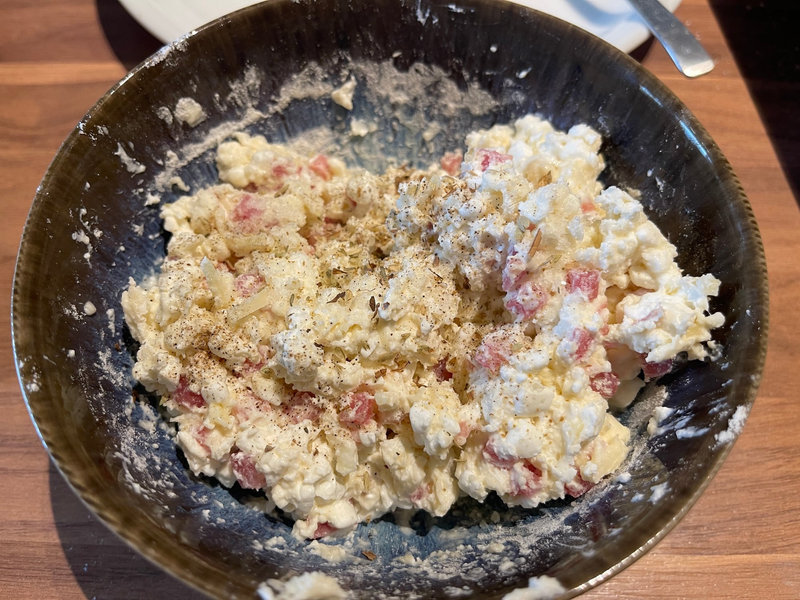
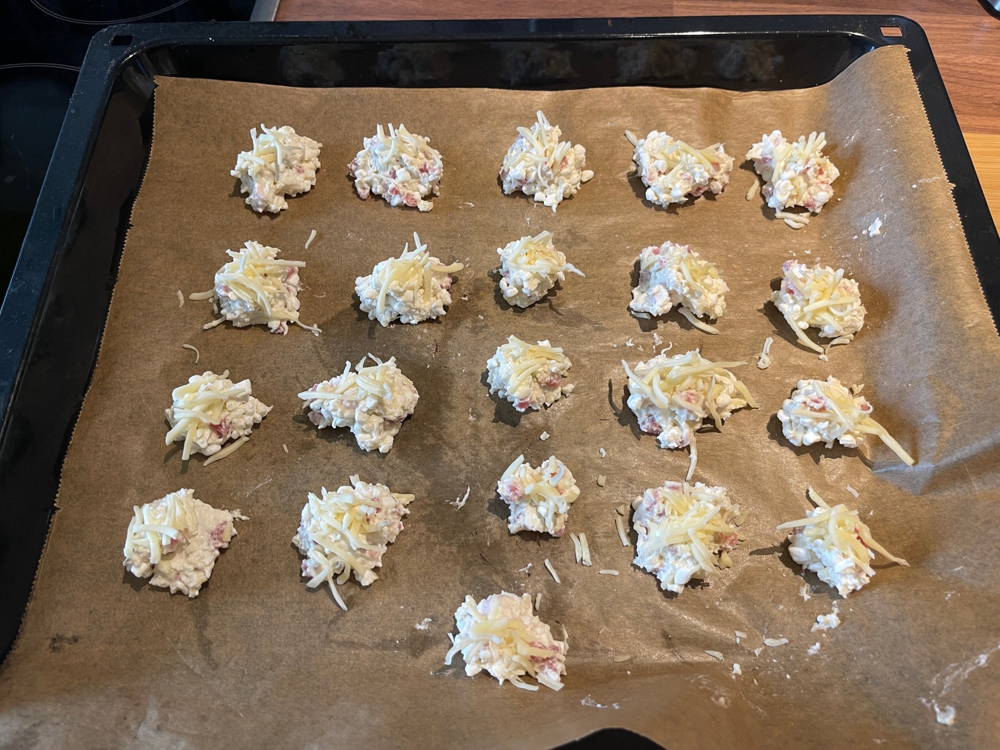

## Zutaten
- {{200 g}} körniger Frischkäse
- {{1}} Eiweiß
- {{60 g}} Mehl
- {{20 g}} Parmesan, gerieben
- {{50 g}} magere Schinkenwürfel
- Salz, Pfeffer, italienische Kräuter

## Equipment
- Backblech mit Backpapier
- 2 Esslöffel

## Zubereitung
1. **Vorbereiten:** Ofen auf 180 °C vorheizen und ein Blech mit Backpapier auslegen.
2. **Teig anrühren:** Frischkäse, Eiweiß, Mehl, {{10 g}} Parmesan und Schinkenwürfel mit Salz, Pfeffer und italienischen Kräutern zu einem klebrigen Teig verrühren.
   
3. **Formen:** Mit zwei Löffeln {{21}} kleine Häufchen aufs Blech setzen und den restlichen Parmesan ({{10 g}}) darüberstreuen.
   
4. **Backen:** Ca. 20 Min. backen, bis die Brötchen goldbraun sind.
5. **Servieren:** Kurz abkühlen lassen und warm oder kalt als Snack servieren.
