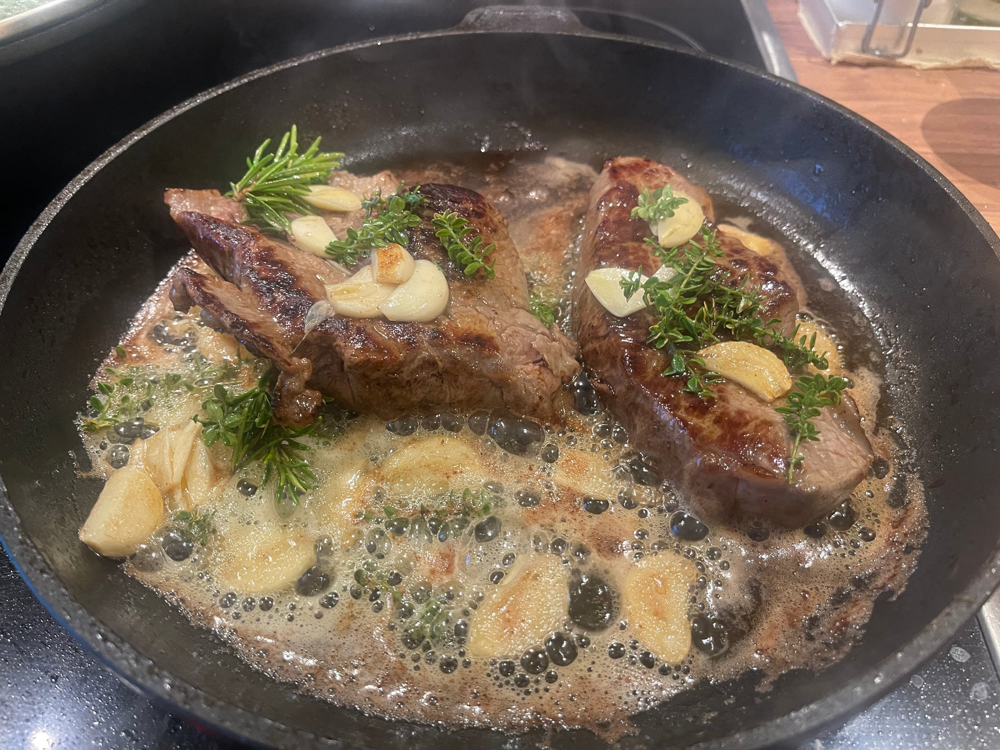

## Zutaten

- {{1}} Steak (ca. 350 g, 2,5–4 cm dick; z. B. Ribeye/Entrecôte oder Rumpsteak)
- {{1–2 TL}} neutrales Öl mit hohem Rauchpunkt (z. B. Raps)
- {{1 EL}} Butter
- {{1–2}} Knoblauchzehen, angedrückt
- {{1–2 Zweige}} Thymian (optional zusätzlich Rosmarin)
- Salz (am besten grob/Meersalz), Pfeffer

## Equipment

- Schwere Pfanne mit Deckel (am besten Gusseisen)
- Zange

## Zubereitung

1. **Vorbereiten:** Steak 45–60 Min. vor dem Braten aus dem Kühlschrank nehmen und sehr gut trocken tupfen.
2. **Pfanne vorheizen:** Pfanne stark erhitzen, Öl hineingeben und das Steak einlegen.
3. **Anbraten:** Steak insgesamt 4 Min. braten und dabei jede Minute wenden. Zu Beginn der letzten Minute die Pfanne bereits von der Platte nehmen.
4. **Mit Butter übergießen:** Butter, Knoblauch und Thymian in die Pfanne geben. Steak immer wieder mit der schäumenden Butter übergießen.
   
5. **Ziehen lassen:** Deckel auflegen und das Steak 5 Min. in der Pfanne ziehen lassen.
6. **Ruhen lassen:** Steak herausnehmen und ca. 3 Min. ruhen lassen.
7. **Servieren:** Salzen, pfeffern, gegen die Faser aufschneiden und servieren.

## Tipps

- Je trockener das Steak, desto besser die Kruste.
- Pfeffer erst zum Schluss: In sehr heißer Pfanne wird er bitter.
- Mit Thermometer: Medium rare bei 52–54 °C, Medium bei 56–58 °C Kerntemperatur.
